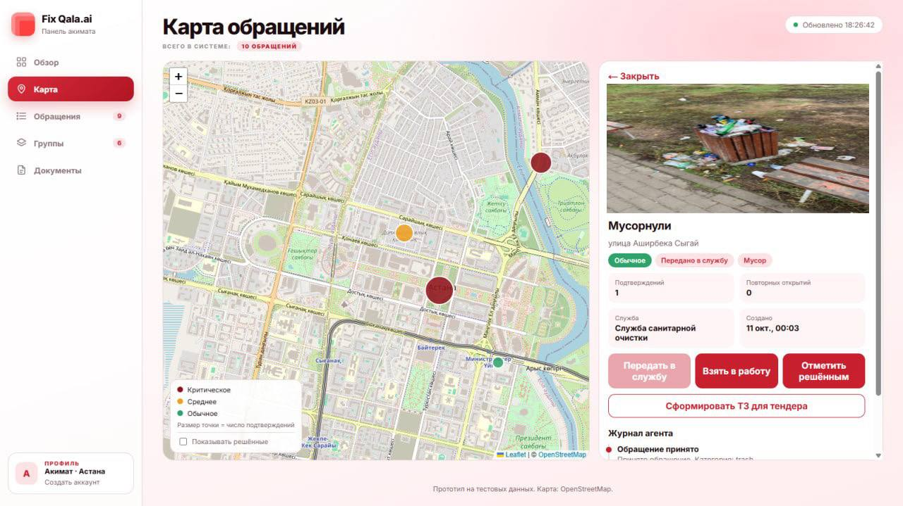

# Fix Qala.ai: приложение жителя

Мобильное приложение для жителей. Сфотографировал проблему, выбрал категорию, отправил. Геопозиция определяется автоматически, а статус обращения виден в приложении.


## Возможности

- Вход по номеру телефона, ЭЦП не нужна (сейчас демо-режим, код показывается на экране)
- Вкладка «Сообщить»: фото, категория, описание, геопозиция
- Вкладка «Рядом»: что уже сообщили рядом, можно нажать «Подтверждаю» вместо нового обращения
- Вкладка «Мои»: статусы обращений (передано в службу, в работе, решено) и подтверждение результата

Обращения попадают в панель акимата: 

## Стек

Expo, React Native, Expo Router, zustand

## Запуск

```bash
npm install
npx expo start
```

В файле `src/api/client.ts` укажи адрес бэкенда: IP твоего компьютера в локальной сети и порт 3000, например `http://192.168.0.18:3000`. Телефон и компьютер должны быть в одной сети.

## Статус

Прототип. SMS-провайдер не подключён, вход работает в демо-режиме.

Связанные репозитории: [бэкенд](https://github.com/zhenisqur/Fix-Qala-BACKEND), [панель акимата](https://github.com/zhenisqur/Fix-Qala.ai-WEB)